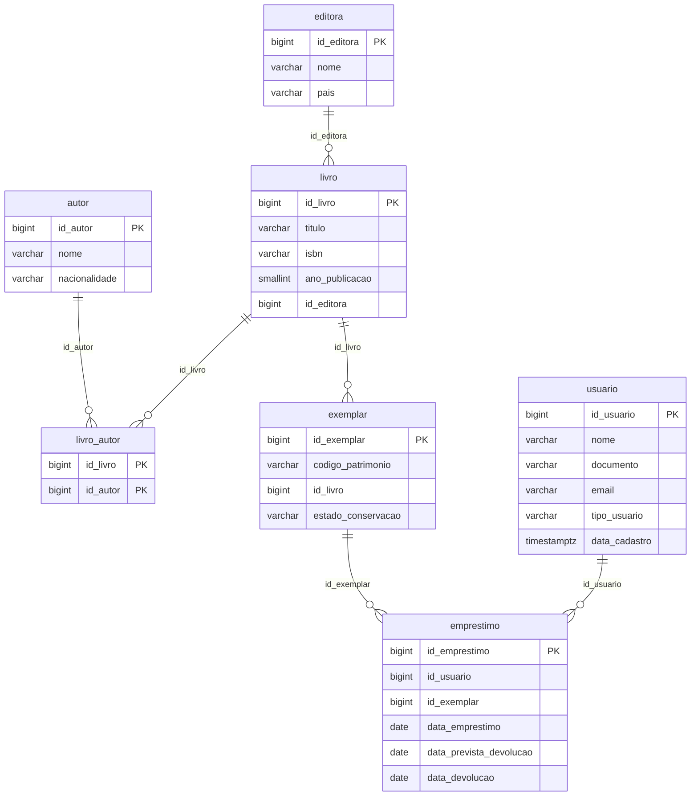

# Diagrama lógico (tabelas e relacionamentos)

[Início](../../README.md) · [Índice](README.md)

Este diagrama é renderizado pelo próprio GitHub — não precisa instalar nada.

## Relacionamentos

| De | Para | Coluna | Regra ao apagar |
|---|---|---|---|
| `emprestimo` | `exemplar` | `id_exemplar` | RESTRICT |
| `emprestimo` | `usuario` | `id_usuario` | RESTRICT |
| `exemplar` | `livro` | `id_livro` | RESTRICT |
| `livro` | `editora` | `id_editora` | RESTRICT |
| `livro_autor` | `autor` | `id_autor` | RESTRICT |
| `livro_autor` | `livro` | `id_livro` | CASCADE |

## Contagem de registros

| Tabela | Registros |
|---|---|
| `autor` | 277 |
| `editora` | 40 |
| `emprestimo` | 2.500 |
| `exemplar` | 744 |
| `livro` | 456 |
| `livro_autor` | 481 |
| `usuario` | 800 |
